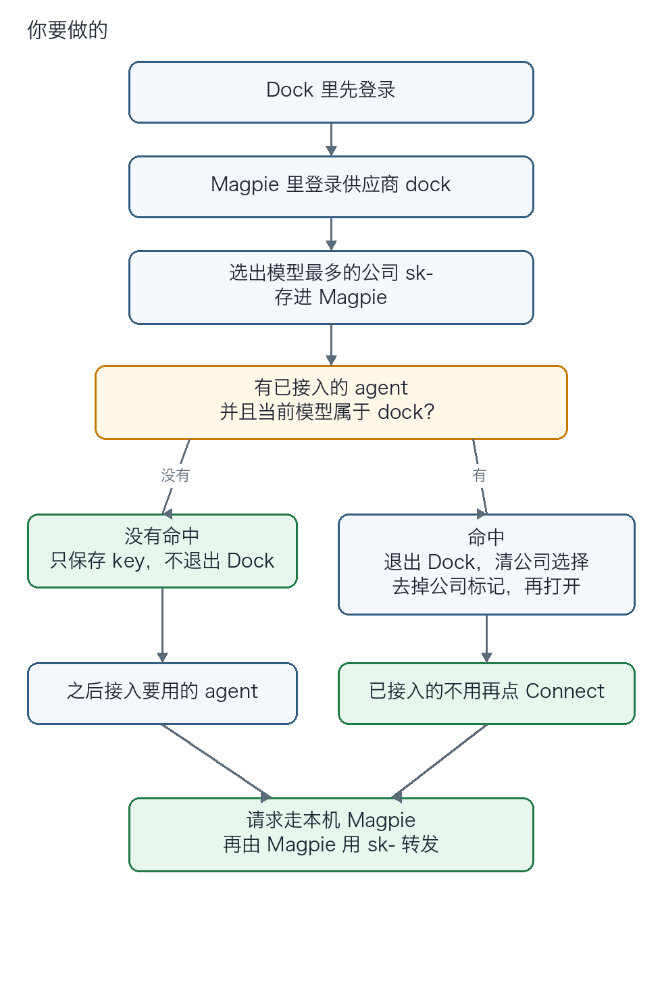
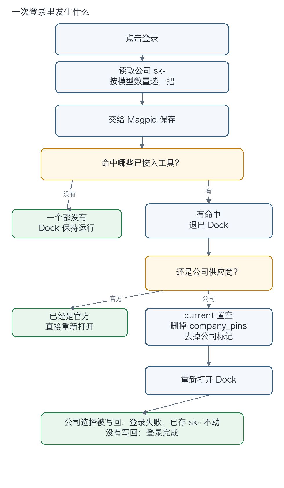
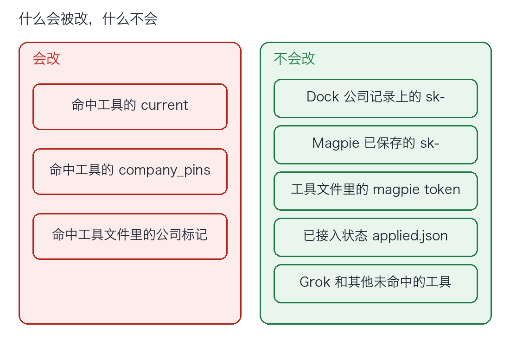

# asteria-dock

Magpie 供应商插件。供应商 id 是 `dock`，和已安装的 `sub2api` 分开。

它做两件事：从已经登录的 Asteria Dock 取出公司 `sk-`，存进 Magpie；如果有 agent 已经接入、并且当前模型属于这家供应商，同一次登录会把这些工具的 Dock 公司选择清掉。

公司记录上的 `sk-` 不删。Magpie 已经存下的 `sk-` 不删。工具文件里的 Magpie 网关 token 不删。

## 先看这一条

Dock 的 Asteria 和 Magpie 不能同时开。

`claude`、`pi`、`opencode`、`codex`、`hermes` 里，同一个工具不能一边在 Dock 里选 Asteria，一边在 Magpie 里接入。两边写的是同一份工具配置，后写的一边会盖掉另一边。

| 谁在写 | 写进工具文件的是 |
| --- | --- |
| Dock 选 Asteria | 公司 `sk-` 和 Dock 下发的站点地址 |
| Magpie 接入 | 网关 token `magpie` 和 `http://127.0.0.1:3425` |

`agy`、`dsh`、`grok` 不在这套清理里。Grok 不支持换模型，登录不改它的 Dock 选择，也不改 `~/.grok/config.toml`。

## 你要做的

Dock 先登录。插件弹不出 Dock 的扫码窗，也弹不出公司站点的登录页。

```sh
magpie plugin add /path/to/asteria-dock
magpie plugin login dock
```

页面上只有一个登录。添加账号和重新登录是同一次操作。



已经接入的 agent 不用再点 Connect。Connect 写的是网关 token，登录不会把它断开，也不会改 `applied.json`。

之后如果又在 Dock 里把某个已接入工具选回 Asteria，再登录一次这个供应商。它按当时的接入和模型重新判断。拉模型、读用量、转发请求都不会退出 Dock。

## 一次登录里发生什么



没有单独的清理按钮。供应商页的沙箱按钮改不了本机文件，所以清理跟登录走同一次点击。

## 什么会被改，什么不会



Magpie 已保存的 `sk-` 在 `~/.config/magpie/plugin-auth.json`。清理不读、不写这个文件。只有这次登录成功，Magpie 才会用新选出的那把覆盖它。登录失败时，原来那把还在。

## 怎么算正在使用这家供应商

两个条件都要满足：

1. `~/.config/magpie/applied.json` 里有这个工具，说明已经接入。
2. 它的第一个模型字段属于 `dock`。

模型名先去掉 `magpie/` 和末尾的 `[1m]`。剩下的是 `dock`、`dock/...` 或 `dock-...`，算命中。

选的是 `group/组id` 时，按 `~/.config/magpie/providers.json` 展开。成员是 `dock/模型` 就算。成员又是组就继续展开。`disabled: true` 的整组跳过。`off` 是关掉的成员列表，只跳过列出的成员。

别的供应商、只是登录了 Dock、没有接入 Magpie，都不算。

## 各工具去掉什么

| 工具 | 文件 | 登录命中后去掉 | 留下 |
| --- | --- | --- | --- |
| Pi | `~/.pi/agent/settings.json`、`models.json` | `asteria_dock`、`providers.asteria`、`*.asteria.bak` | `providers.magpie` 和网关 token |
| OpenCode | `~/.config/opencode/opencode.json` | `providers.asteria`、`provider.asteria`、`asteria/` 模型、公司地址 | Magpie 自己的 provider |
| Codex | `~/.codex/config.toml` | `[model_providers.asteria]`；当前地址是公司站点时改到 `magpie` | `[model_providers.magpie]` 和 token `magpie` |
| Claude | `~/.claude/settings.json` | env 里的公司 `sk-` 和公司站点；Claude 已接入且模型属于这家供应商时，登录去掉 `availableModels`、`enforceAvailableModels`、`deniedModels` | `ANTHROPIC_AUTH_TOKEN=magpie`、`ANTHROPIC_BASE_URL=http://127.0.0.1:3425`，以及 `model`、`modelPicker`、其余配置 |
| Hermes | `~/.hermes/config.yaml` | 带公司地址、`sk-` 或 Dock 注释的行 | 其余配置 |

Dock 认的公司标记还在时，启动对账会把 `current` 写回公司供应商。所以这三步要一起做：`current` 置空、删掉 `company_pins` 这个键、去掉工具文件里的公司标记。空的 pin 对象不算删掉。

## 选哪把 key

公司 key 在 `~/.asteria-dock/config.json` 的 `providers[]` 里，`kind` 是 `company`，值以 `sk-` 开头。`session.json` 里的 `sso_token` 不是这把 key。

跳过 `disabled`、`expired`、`quota_exhausted`、`unsupported`。同一把 key 只计一次。数量按实时 `GET /v1/models`，不按 Dock 缓存的模型数。数量相同用较新的 `updated_at`。

站点地址用 Dock 下发的 `base_url`。插件里不写地址。没有 `base_url` 的记录不参与选 key。

模型按 id 选协议：Claude 用 `@ai-sdk/anthropic`，`gpt-`、`oN`、`codex-` 用 `@ai-sdk/openai`，其余用 `@ai-sdk/openai-compatible`。三个 Trae 模型 `deepseek-flash-trae`、`glm-5.3-trae`、`glm-5.3-flashx-trae` 补了 1M 上下文，供 Magpie 显示。

## 出了问题看哪里

用量卡片提示某个工具仍是公司配置时，再登录一次。账号卡片上的刷新只读用量，不会清理。Dock 没有额度接口，所以这里仍显示暂无额度。

登录失败并提示 `current` 或 `company_pins` 又被写回，说明工具文件里的公司标记还在，Dock 启动时写回去了。再登录一次会按当时命中的工具重做。已保存的 `sk-` 不会因为这次失败被清掉。

清理中途失败、Dock 还没重新打开时，插件会再打开一次 Dock。带 Magpie token 的工具文件如果被改过，会按去掉公司标记之后的内容写回。

macOS 上 Dock 配置在 `~/.asteria-dock/`，启动日志在 `~/Library/Logs/com.asteria.dock/Asteria Dock.log`。Windows 先找 `%LOCALAPPDATA%\AsteriaDock`，没有再找 `%USERPROFILE%\.asteria-dock`。退出和重新打开只在 macOS 上验证过。
